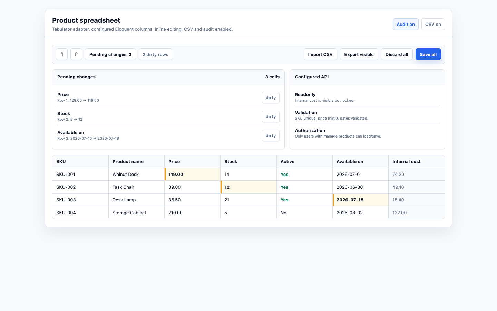
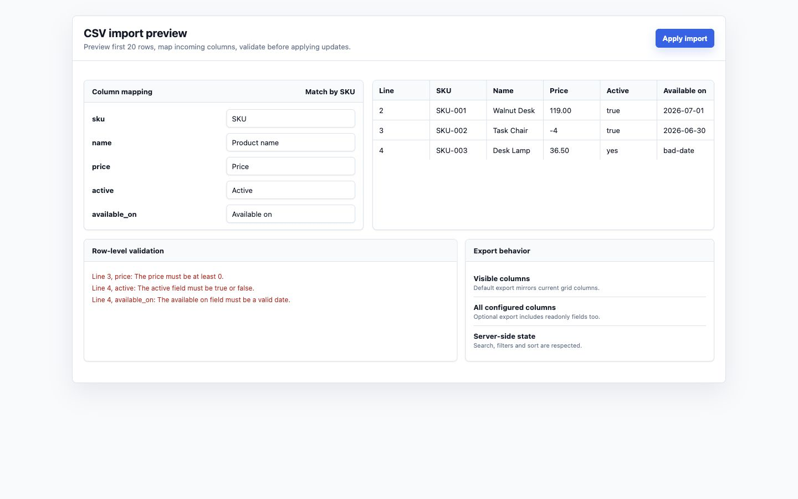
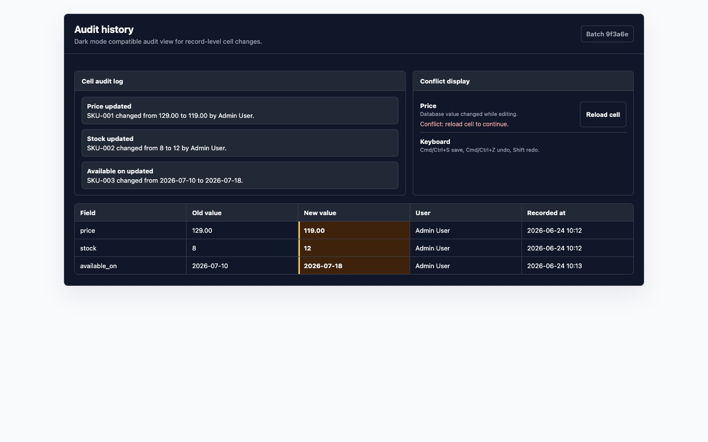

# Filament Spreadsheet Editor

Current release: [v0.2.0](https://github.com/mchtylmz/Filament-Spreadsheet-Editor/releases/tag/v0.2.0). See the [changelog](CHANGELOG.md) for compatibility changes and upgrade instructions.

Excel-like editing for Filament v5 panels, powered by Eloquent, Livewire v4, Alpine.js, Vite, and a grid-adapter architecture that starts with Tabulator and leaves room for AG Grid.

Filament Spreadsheet Editor helps teams edit operational data without leaving their admin panel: products, prices, stock, catalog metadata, tenant-scoped records, approval queues, and any Eloquent-backed dataset that benefits from fast spreadsheet workflows.

## Screenshots

Demo previews (illustrative sample data):



| CSV import preview | Audit history |
| --- | --- |
|  |  |

## Features

- Filament v5 plugin registration with a fluent public API.
- Excel-like Tabulator grid adapter with editable cells, row selection, clipboard copy/paste, dirty-cell styling, undo/redo, save all, discard all, and beforeunload protection.
- Type-aware columns: text, number, integer, boolean, and date.
- Server-side pagination, sorting, searching, and column filters.
- Server-side validation using Laravel-compatible rules defined on `SpreadsheetColumn`.
- Batch updates with optimistic locking, transactions, per-cell results, and conflict recovery.
- CSV export with visible-column export by default and all-configured-column export when requested.
- CSV import with column mapping, first-20-row preview, row-level validation, primary-key or unique-column matching, and optional queue support.
- Audit logging for cell edits with redaction support for sensitive fields.
- Tenant-aware query hook for Filament tenancy.
- Adapter contract for future grid implementations such as AG Grid.
- Pest, PHPStan, Pint, Vite, and GitHub Actions CI included.

## Requirements

- PHP 8.2+ (PHP 8.3+ for Laravel 13)
- Laravel 12.69+ or 13.30+
- Filament v5
- Livewire v4
- Node.js 20.19+ or 22.12+ for asset builds

Compatibility checked on November 9, 2026 with **Laravel 13.40.0, Filament 5.11.2, Livewire 4.4.8, and PHP 8.4**. Composer constraints allow Laravel 12.69+ / 13.30+ and future compatible Filament 5 / Livewire 4 releases. CI covers Laravel 12 on PHP 8.2, 8.3, and 8.4, and Laravel 13 on PHP 8.3 and 8.4. Every matrix job runs `composer audit --locked` alongside tests and static analysis.

See the upstream release notes for [Filament 5.11.2](https://github.com/filamentphp/filament/releases/tag/v5.11.2) and [Livewire 4.4.8](https://github.com/livewire/livewire/releases/tag/v4.4.8).

## Installation

```bash
composer require mchtylmz/filament-spreadsheet-editor
```

Publish the configuration:

```bash
php artisan vendor:publish --tag=filament-spreadsheet-editor-config
```

Install the registered JavaScript and CSS through Filament's asset pipeline:

```bash
php artisan filament:assets
```

Publish audit migrations only when audit logging is enabled:

```bash
php artisan vendor:publish --tag=filament-spreadsheet-editor-migrations
php artisan migrate
```

More detail: [docs/installation.md](docs/installation.md)

## Filament v5 PanelProvider Registration

```php
use Filament\Panel;
use Mivento\FilamentSpreadsheetEditor\SpreadsheetEditorPlugin;

public function panel(Panel $panel): Panel
{
    return $panel
        ->plugin(
            SpreadsheetEditorPlugin::make()
                ->defaultAdapter('tabulator')
                ->enableAuditLog()
                ->enableCsvImport()
                ->enableCsvExport()
        );
}
```

CSV and audit features are disabled by default and can be enabled through the plugin or the published configuration.

## Basic Usage

Create a Filament page:

```bash
php artisan make:filament-page ProductSpreadsheet
```

Render the package component:

```blade
{{-- resources/views/filament/pages/product-spreadsheet.blade.php --}}
<x-filament-panels::page>
    <x-filament-spreadsheet-editor::spreadsheet-editor :editor="$this->editor()" />
</x-filament-panels::page>
```

Register a named editor in `AppServiceProvider::boot()` so row loading, saving, and CSV actions can resolve it on every request:

```php
namespace App\Providers;

use App\Models\Product;
use Illuminate\Database\Eloquent\Builder;
use Illuminate\Support\ServiceProvider;
use Mivento\FilamentSpreadsheetEditor\SpreadsheetColumn;
use Mivento\FilamentSpreadsheetEditor\SpreadsheetEditor;
use Mivento\FilamentSpreadsheetEditor\Support\SpreadsheetEditorRegistry;

class AppServiceProvider extends ServiceProvider
{
    public function boot(SpreadsheetEditorRegistry $editors): void
    {
        $editors->define('products', fn () => SpreadsheetEditor::make()
            ->model(Product::class)
            ->columns([
                SpreadsheetColumn::make('sku')->label('SKU')->text()->required()->unique()->searchable(),
                SpreadsheetColumn::make('name')->text()->required()->max(120)->searchable()->editable(),
                SpreadsheetColumn::make('price')->numeric()->min(0)->editable(),
                SpreadsheetColumn::make('stock')->integer()->min(0)->editable(),
                SpreadsheetColumn::make('active')->boolean()->editable(),
                SpreadsheetColumn::make('available_on')->date()->editable(),
                SpreadsheetColumn::make('internal_cost')->numeric()->readOnly(),
            ])
            ->importUniqueColumn('sku')
            ->query(fn (Builder $query): Builder => $query->where('active', true))
            ->authorize(fn ($user): bool => $user?->can('manage products') === true));
    }
}
```

Resolve that named editor from the Filament page:

```php
namespace App\Filament\Pages;

use BackedEnum;
use Filament\Pages\Page;
use Mivento\FilamentSpreadsheetEditor\SpreadsheetEditor;
use Mivento\FilamentSpreadsheetEditor\Support\SpreadsheetEditorRegistry;

class ProductSpreadsheet extends Page
{
    protected static string|BackedEnum|null $navigationIcon = 'heroicon-o-table-cells';

    protected string $view = 'filament.pages.product-spreadsheet';

    public function editor(): SpreadsheetEditor
    {
        return app(SpreadsheetEditorRegistry::class)->editor('products');
    }
}
```

Configure the `manage products` permission in your application, or replace the authorization callback with your existing policy check. Column names must match your model's attributes. Unregistered editor instances are intended for local/demo data and do not persist changes to Eloquent.

## Tenant-Scoped Editors

For tenant-owned models, add these calls to the registered editor definition. The example assumes the model has a relationship to the Filament tenant:

```php
->tenantQuery(fn ($query, $tenant) => $query->whereBelongsTo($tenant))
->requiresTenant()
```

## Authorization

Every real editor should define an authorization callback:

```php
->authorize(fn ($user): bool => $user?->can('manage products') === true)
```

The callback is checked before row loading, saving, CSV export, and CSV import. Unauthenticated users are blocked by the package middleware group, which is populated from the registered Filament panel by default.

## Validation

Column validation is declared in PHP and enforced server-side during save and CSV import:

```php
SpreadsheetColumn::make('price')
    ->numeric()
    ->min(0)
    ->editable();

SpreadsheetColumn::make('sku')
    ->required()
    ->unique();
```

`unique()` is resolved against the configured Eloquent model table when possible. Server responses include per-cell statuses such as `success`, `validation_error`, `conflict`, and `forbidden`.

More detail: [docs/columns.md](docs/columns.md)

## CSV Import and Export

Enable CSV features:

```php
SpreadsheetEditorPlugin::make()
    ->enableCsvImport()
    ->enableCsvExport();
```

Export respects configured columns, current filters, search, and sort. Visible columns are exported by default; users can request all configured columns. Imports support upload, mapping, preview, validation, and apply-by-primary-key or apply-by-unique-column workflows.

CSV values beginning with `=`, `+`, `-`, or `@` are escaped to reduce spreadsheet formula injection risk.

More detail: [docs/import-export.md](docs/import-export.md)

## Audit Logging

Enable audit logging:

```php
SpreadsheetEditorPlugin::make()->enableAuditLog();
```

Publish and run the audit migration:

```bash
php artisan vendor:publish --tag=filament-spreadsheet-editor-migrations
php artisan migrate
```

Add the relationship trait to audited models:

```php
use Mivento\FilamentSpreadsheetEditor\Concerns\HasSpreadsheetCellAudits;

class Product extends Model
{
    use HasSpreadsheetCellAudits;
}
```

Sensitive fields are redacted by default:

```php
'sensitive_fields' => ['password', 'api_token', 'secret_key'],
'audit' => [
    'redact_sensitive_fields' => true,
    'redacted_value' => '[redacted]',
],
```

More detail: [docs/audit-log.md](docs/audit-log.md)

## Configuration

Key options in `config/filament-spreadsheet-editor.php`:

```php
'grid' => [
    'adapter' => 'tabulator',
],
'csv_import_enabled' => false,
'csv_export_enabled' => false,
'audit_enabled' => false,
'max_sync_import_rows' => 1000,
'import_disk' => 'local',
'import_ttl_minutes' => 60,
'routes' => [
    'prefix' => 'filament-spreadsheet-editor',
    'middleware' => ['filament-spreadsheet-editor'],
    'use_panel_middleware' => true,
],
```

More detail: [docs/configuration.md](docs/configuration.md)

## Troubleshooting

**The grid renders but does not load backend rows.**
Use a named editor from `SpreadsheetEditorRegistry`. Raw editor instances run in local/mock mode and do not expose backend URLs.

**POST requests fail with 419.**
Keep the default `filament-spreadsheet-editor` middleware group or include `web` in your custom middleware. The bundled JavaScript reads the CSRF token from standard Laravel page metadata.

**The console reports `Invalid column definition option` for `type`, `searchable`, or `validationRules`.**
Update to a package revision containing the fix for [#1](https://github.com/mchtylmz/Filament-Spreadsheet-Editor/issues/1), run `php artisan filament:assets`, and refresh the browser cache. The Tabulator adapter keeps spreadsheet metadata separate from Tabulator's column options.

**CSV import updates no rows.**
Check the mapping, `match_by`, and `->importUniqueColumn('sku')` configuration.

**Audit rows are empty or not created.**
Enable audit logging, publish and run migrations, and ensure the batch actually commits.

**Tenant records leak across panels.**
Add `tenantQuery()` to every editor whose model belongs to a tenant. For fail-closed tenant-owned editors, add `->requiresTenant()` so requests without a Filament tenant context are rejected.

## Upgrade Notes

- Keep PHP, Laravel, Filament, and Livewire versions aligned with the requirements above.
- Run `php artisan filament:assets` after updating the package so Filament serves the current compiled assets.
- Review `config/filament-spreadsheet-editor.php` for new security or feature flags.
- Run `composer ci` locally before upgrading production apps.
- Watch release notes for adapter-level changes when AG Grid support is introduced.

Laravel 11 support has been removed: its [security support has ended](https://laravel.com/docs/11.x/releases#support-policy), and the security fixes required by this package's dependency checks are available in Laravel 12/13. Upgrade Laravel 11 applications to Laravel 12.69+ or 13.30+ before installing this revision. Composer security blocking remains enabled; no advisories are ignored.

Laravel 13 requires PHP 8.3+. Package contributors testing Laravel 13 use Testbench 11 and Pest 4; Laravel 12 on PHP 8.2 retains compatible Testbench 10 and Pest 3 dependency ranges. When extending Filament pages, match the current property types, including `string|BackedEnum|null` for `$navigationIcon`.

## Roadmap

- AG Grid adapter implementation.
- Column grouping and frozen columns.
- Bulk fill and formula-like helper actions.
- Saved grid views per user.
- Import templates and downloadable CSV examples.
- Optional queued export jobs for very large datasets.

## FAQ

**Does this replace Filament tables?**
No. It complements Filament tables when users need spreadsheet-style inline editing and batch save workflows.

**Can I use it with any Eloquent model?**
Yes, as long as the editor is configured server-side and only safe columns are exposed.

**Are columns editable by default?**
No. Columns are read-only until you call `editable()`.

**Can users write hidden or unconfigured fields?**
No. Save and import endpoints only accept configured editable columns.

**Does it support tenancy?**
Yes. Add `tenantQuery()` so all reads and writes are scoped to the active Filament tenant.

**Is AG Grid supported today?**
Not yet. The adapter contract exists so AG Grid can be added without changing the public editor API.

## Documentation

- [Installation](docs/installation.md)
- [Configuration](docs/configuration.md)
- [Columns](docs/columns.md)
- [Import and Export](docs/import-export.md)
- [Audit Log](docs/audit-log.md)
- [Security](docs/security.md)

## Development

```bash
composer install
npm ci
composer ci
```

Individual commands:

```bash
composer test
composer analyse
composer format
composer build
npm test
```
